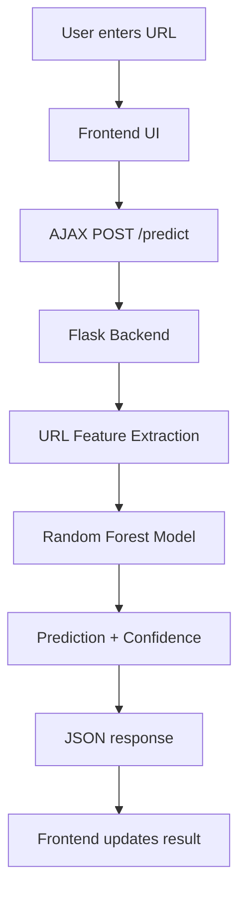
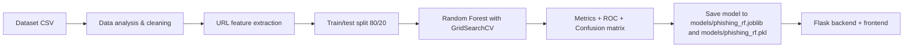

# Phishing URL Detection System

## Project Abstract
This project builds an end-to-end phishing URL detection system using a Random Forest classifier. It includes dataset analysis, feature engineering, model training, explainability, Flask backend deployment, and a responsive frontend for real-time URL checks.

## Problem Statement
Phishing URLs are widely used to trick users into giving up credentials and personal data. This project detects malicious URLs by extracting URL-based features and classifying them as either phishing or legitimate.

## Objectives
- Analyze and preprocess the phishing URL dataset.
- Build and tune a Random Forest classification model.
- Save the model in both `joblib` and `pickle` formats.
- Deploy a Flask backend that serves live URL predictions.
- Build a responsive frontend with dynamic DOM rendering and dark mode.
- Provide explainability using feature importance and visualizations.

## Folder Structure
```
project/
│
├── app.py
├── feature_extraction.py
├── training.py
├── requirements.txt
├── README.md
├── dataset/
│   └── phishing.csv
├── models/
│   ├── phishing_rf.joblib
│   └── phishing_rf.pkl
├── static/
│   ├── css/
│   │   └── style.css
│   ├── js/
│   │   └── script.js
│   └── images/
│       ├── correlation_heatmap.png
│       ├── target_distribution.png
│       ├── feature_distributions.png
│       ├── pairplot_top_features.png
│       ├── feature_importance.png
│       ├── confusion_matrix.png
│       └── roc_curve.png
├── templates/
│   └── index.html
├── notebooks/
│   └── training.ipynb
└── dataset/
    └── phishing.csv
```

## Architecture Diagram


## Workflow Diagram


## Dataset Analysis
The project analyzes the dataset and prints:
- Dataset shape (rows and columns)
- Column names and data types
- Missing value counts
- Duplicate record count
- Statistical summary for numeric columns
- Target class distribution

The training pipeline also generates visualizations including:
- Correlation heatmap
- Target class distribution
- Feature distribution plots
- Pair plots for top correlated features
- Feature importance ranking

## Methodology
1. Load the URL dataset from `dataset/phishing.csv`.
2. Preprocess the data by removing duplicates, handling missing values, and extracting URL-level features.
3. Split the dataset into 80% training and 20% testing.
4. Train a Random Forest classifier using `GridSearchCV` for hyperparameter tuning.
5. Evaluate the model with accuracy, precision, recall, F1 score, confusion matrix, ROC AUC, and classification report.
6. Save the trained model in both `joblib` and `pickle` formats.
7. Deploy the model with a Flask API and a responsive frontend.

## How to Run
```powershell
cd "Summer Project"
python -m venv .venv
.venv\Scripts\Activate.ps1
pip install -r requirements.txt
python training.py
python app.py
```

Then open:

`http://127.0.0.1:5000`

## Deployment Instructions
1. Create a Python virtual environment.
2. Activate the environment.
3. Install dependencies from `requirements.txt`.
4. Run `python training.py` to generate the trained model.
5. Run `python app.py` to start the Flask backend.
6. Access the app at `http://127.0.0.1:5000`.

## Results and Model Explainability
The system produces:
- Accuracy, precision, recall, and F1 score
- Confusion matrix and ROC curve
- Feature importance ranking
- Dataset visualizations

Because the sample dataset is small, the metrics are illustrative; a larger dataset will improve generalization.

## Future Scope
- Add URL content and WHOIS features.
- Use deep learning or ensemble stacking.
- Add batch URL scanning and CSV upload.
- Deploy to Docker or cloud hosting.

## Conclusion
This project demonstrates a complete phishing URL detection pipeline from dataset analysis through deployment. It combines robust feature engineering, model evaluation, explainability, and a real-time Flask + JavaScript user experience.
