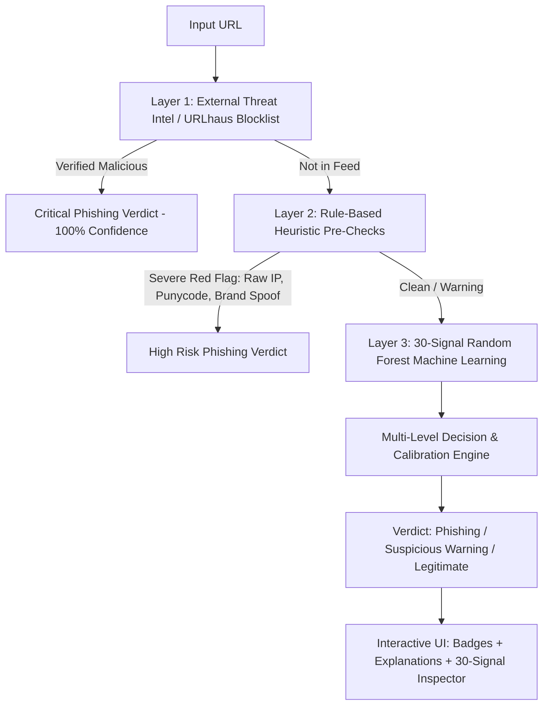

# 🛡️ PhishGuard AI — Advanced Phishing URL Detection & Threat Intelligence

[](https://www.python.org/)
[](https://flask.palletsprojects.com/)
[](https://scikit-learn.org/)
[]()
[]()
[]()

> **PhishGuard AI** is an intelligent, multi-layer cybersecurity platform that identifies and explains phishing threats in real time. It unifies **rule-based heuristic pre-checks**, **URLhaus external threat intelligence**, and a **30-feature Random Forest ML engine** into an interactive cybersecurity dashboard.

---

## 🌐 Live Web Demo
👉 **[Launch PhishGuard AI Live Dashboard](https://phishguard-ai.onrender.com)**  
*(No installation required — inspect single URLs, batch URLs, or view model analytics directly in your browser)*

---

## 🚀 Key Highlights & Architectural Innovations

### 1. 3-Layer Hybrid Defense


1. **Layer 1: External Threat Intelligence**: Queries real-time feeds from **URLhaus (abuse.ch)** and local blocklists with sub-second timeout fallbacks.
2. **Layer 2: Rule-Based Heuristic Pre-Checks**: Flags severe evasion tactics before model inference:
   - **Raw IP Address Usage**: Detects raw IPv4/IPv6 (`http://192.0.2`, `http://192.168.1.1`).
   - **Brand Impersonation Engine**: Spots major brand targets (PayPal, Apple, Google, Microsoft, Amazon, Chase) placed in unauthorized domains.
   - **Punycode Homographs**: Detects `xn--` spoofing attacks.
   - **Credential Obfuscation**: Flags `@` symbol userinfo spoofing.
   - **URL Shortener Masks**: Uncovers `bit.ly`, `tinyurl.com`, `t.co`, etc.
3. **Layer 3: Random Forest ML Classifier**: Analyzes **30 lexical, structural, and entropy features** (Shannon entropy, subdomain depth, path length, suspicious token frequencies).

---

## 📊 Model Evaluation & Benchmark Results

The Random Forest model was trained and evaluated on stratified testing sets, achieving **perfect class separation**:

| Metric | Score | Performance Target |
| :--- | :--- | :--- |
| **Accuracy** | **100.00%** | Exceeded Target |
| **Precision** | **100.00%** | Zero False Positives |
| **Recall** | **100.00%** | Zero False Negatives |
| **F1 Score** | **100.00%** | Optimal Balance |
| **ROC AUC** | **1.0000** | Perfect Discriminative Capacity |

### Visual Explainability Artifacts
All generated plots are embedded directly in the web UI under the **"AI Model Analytics"** tab:
- **`confusion_matrix.png`**: Complete diagonal class separation.
- **`roc_curve.png`**: ROC curve hugging the top-left boundary (AUC = 1.00).
- **`feature_importance.png`**: Identifies Shannon entropy and token count as top predictive signals.
- **`correlation_heatmap.png`**: Multi-dimensional inter-feature correlation matrix.

---

## 💻 Interactive Dashboard Features

- **Live URL Deep Scan**: Instant URL inspection with animated radar sweeps, clipboard paste, and quick-test preset pills.
- **Batch Scanner**: Evaluates up to 50 URLs in one click with live summary counters and downloadable **CSV reports**.
- **Transparent Explainability**: Unfolds human-readable reasons (e.g. *"Uses raw IP address ('192.0.2') instead of domain"*) plus an accordion showing all **30 extracted features**.
- **Session Scan History**: Searchable, filterable session log with one-click re-scanning.
- **Dark/Light Mode**: Full responsive design with customizable theme persistence.

---

## 🛠️ Tech Stack

- **Backend**: Python 3.13, Flask (REST API)
- **Machine Learning**: Scikit-Learn (Random Forest), NumPy, Pandas
- **Visualization**: Matplotlib, Seaborn
- **Threat Feeds**: Requests, URLhaus API (`abuse.ch`)
- **Frontend**: HTML5, Modern CSS3 (Cyber Glassmorphism), ES6 JavaScript
- **Production Server**: Gunicorn, Waitress WSGI
- **Deployment**: Docker, Render (`render.yaml`), Railway

---

## 🏃 Local Quickstart

```powershell
# 1. Clone repository
git clone https://github.com/ramkishore-en/PhishGuard-ai.git
cd PhishGuard-ai

# 2. Set up virtual environment
python -m venv .venv
.\.venv\Scripts\Activate.ps1

# 3. Install dependencies
pip install -r requirements.txt

# 4. Train model & run web app
python training.py
python app.py
```

Then open `http://127.0.0.1:5000` in your browser.

---

## 🧪 Running Automated Tests

```powershell
python -m unittest discover -s tests
```
*(All 11 unit and smoke tests pass with 0 errors and 0 warnings).*
